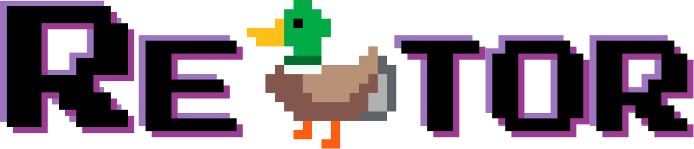

  

  
  
  
  
  

**Re🦆tor** is a web tool that helps you remove sensitive information from text, including emails and log files. Use it to safely prepare text for pasting into an LLM chat or sharing with support.

# Features

- **Custom Redactor**: Enter custom strings to remove sensitive information from your text.
- **Thematic Redactors**: Use thematic redaction options (based on [Compromise](https://github.com/spencermountain/compromise)) to remove sensitive information from your text.
- **Name Redactor (decrepated)**: Use experimental name redaction to remove common first and last names from different regions. The names were selected from the Python [names-dataset](https://pypi.org/project/names-dataset/).

## How to use

## Thematic NLP

Use the buttons to replace patterns from the predefined categories (e.g., emails, places, and names) with functionalities from the compromise NLP library. The names category mostly covers Anglophone names.

There are no API calls, the NLP library is vendored locally and runs client-side.

## Custom word patterns

Write one pattern per line in the pattern box; each line is redacted wherever
it appears in the text, using your selected placeholder style.

To replace a word with a specific word instead of the placeholder, write
`target /%/ replacement` — for example, `Peter /%/ Reuben` turns every
"Peter" in the text into "Reuben". (Spaces around `/%/` are optional:
`Peter/%/Reuben` works the same.)

### Edge cases

| Case             | Patterns in the box                        | Text                                     | Result                                                                                                            |
| ---------------- | ------------------------------------------ | ---------------------------------------- | ----------------------------------------------------------------------------------------------------------------- |
| Substring safety | `Peter`                                    | `Peterson met Peter.`                    | `Peterson met █████.` — patterns match whole words only, never inside longer words                                |
| Pair beats plain | `Peter /%/ Reuben` and `Peter`             | `Peter called.`                          | `Reuben called.` — `/%/` pairs always take precedence over plain patterns, regardless of line order               |
| Last pair wins   | `Peter /%/ Reuben` and `Peter /%/ Günther` | `Peter called.`                          | `Günther called.` — when two pairs share a target, the last line is applied                                       |
| Word boundaries  | `Peter`                                    | `Peter, #Peter, Peter! … 1Peter, aPeter` | `█████, #█████, █████! … 1Peter, aPeter` — letters and digits count as word characters, punctuation and `#` don't |

### Reverse mode

Swaps targets and replacements: "Peter /%/ Ruben" turns "Ruben" back into "Peter".
Plain patterns without /%/ are ignored in reverse mode. If two patterns map to the same replacement word, the last pair wins — choose unique replacements.

## Privacy

All patterns and replacements stay in your browser: nothing is stored,
logged, or sent anywhere. Verify it yourself: open DevTools → Network tab,
run a redaction — zero requests. This is enforced by Content-Security-Policy,
not just by our code.

# Dependencies

The thematic redactors rely on the JS modules `compromise` and `compromise-dates`.
Fixed versions are pinned in `package-lock.json` and vendored locally under `/vendor`.
See `vendor/MANIFEST.md` for exact versions and sources.

**Dependabot** tracks upstream releases and opens a PR when a newer version is
available. Vendor updates are generated by `scripts/vendor-audit.sh`.

**Reason**: Instead of loading NLP libraries from a public CDN at runtime, the
vendor pinned builds of compromise and compromise-dates are stored in `vendor/`.

> Check for vulnerabilities on [socket.dev](socket.dev) to be safe.

# Local Testing

From root folder run one of the following to start a local development server:

- `npx serve`
- `python -m http.server 8000`

Open localhost in browser for testing.

# Credits

All fonts and icons are self-hosted; nothing is loaded from third-party servers.

- **[Syne Mono](https://fonts.google.com/specimen/Syne+Mono)** — originally designed
  in 2017 by Bonjour Monde (Lucas Descroix) for the Art Center "Synesthésie",
  Saint-Denis. Licensed under the SIL Open Font License 1.1
  ([license file](assets/fonts/syne-mono-OFL.txt)). Served: latin, latin-ext.
- **[Press Start 2P](https://fonts.google.com/specimen/Press+Start+2P)** — designed
  by CodeMan38, based on the font design of 1980s Namco arcade games. Licensed
  under the SIL Open Font License 1.1
  ([license file](assets/fonts/press-start-2p-OFL.txt)). Served: latin, latin-ext.
- **Font Awesome Free 6.5.0** — © Fonticons, Inc. Icons licensed under
  CC BY 4.0, fonts under the SIL Open Font License 1.1, code under the MIT
  License ([license file](assets/fontawesome/LICENSE.txt)).
